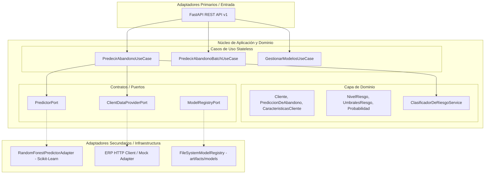

# Motor de Inferencia de Abandono de Clientes (Gym Churn Prediction Engine)

Motor de Machine Learning desarrollado con **Arquitectura Hexagonal (Ports & Adapters)** y **Random Forest Classifier** para la predicción temprana de abandono (churn) de clientes en el ERP de un gimnasio.

Diseñado como un **servicio puramente stateless**: no almacena en una base de datos propia; recibe datos de clientes o características directas, ejecuta la inferencia en memoria con Random Forest calibrado y devuelve la evaluación para que sea persistida por el ERP.

---

## 🏛️ Arquitectura Hexagonal (Stateless)

El sistema desacopla estrictamente las reglas de negocio del framework web (FastAPI) y de la biblioteca de Machine Learning (Scikit-Learn).



---

## 🚀 Inicio Rápido

### 1. Requisitos
- Python 3.11+
- Git

### 2. Instalación de Dependencias
```bash
cd gym-churn-prediction
pip install -e .[dev]
```

### 3. Generar Dataset Sintético y Entrenar Modelo
```bash
python scripts/generate_synthetic_data.py
python scripts/train_and_evaluate.py
```

### 4. Ejecutar la Suite de Pruebas
```bash
python -m pytest tests -v
```

### 5. Levantar el Motor de Inferencia en Desarrollo
```bash
uvicorn churn_prediction.main:app --reload --port 8000
```
- **Documentación Swagger UI**: [http://localhost:8000/docs](http://localhost:8000/docs)
- **Documentación ReDoc**: [http://localhost:8000/redoc](http://localhost:8000/redoc)
- **Liveness probe**: [http://localhost:8000/health/live](http://localhost:8000/health/live)
- **Readiness probe**: [http://localhost:8000/health/ready](http://localhost:8000/health/ready)

### 6. Despliegue con Docker Compose (Contenedor Único Stateless)
```bash
docker compose up -d --build
```

---

## 📊 Métricas del Modelo Random Forest (Conjunto Independiente de Prueba)

El pipeline incluye calibración sigmoid mediante `CalibratedClassifierCV` y división estrictamente temporal para evitar fuga de información:

| Métrica | Valor Obtenido |
|---|---:|
| **Accuracy** | **86.07%** |
| **ROC-AUC** | **0.8998** |
| **PR-AUC** | **0.8231** |
| **Recall (Abandono)** | **76.92%** |
| **Precision (Abandono)** | **76.92%** |
| **F1-Score** | **0.7692** |
| **Brier Score** | **0.1061** |

---

## 📑 Índice de Documentación Detallada

Consulte los documentos en el directorio [`docs/`](./docs/):

1. [Arquitectura Hexagonal y Puertos/Adaptadores](./docs/arquitectura.md)
2. [Modelo de Dominio y Entidades](./docs/modelo_dominio.md)
3. [Variables Predictoras y Feature Engineering](./docs/variables_predictoras.md)
4. [Construcción de Etiquetas y Aislamiento Temporal](./docs/construccion_etiquetas.md)
5. [Pipeline de Machine Learning](./docs/pipeline_ml.md)
6. [Entrenamiento y Ajuste de Hiperparámetros](./docs/entrenamiento.md)
7. [Evaluación de Métricas y Permutación](./docs/evaluacion.md)
8. [Calibración de Probabilidades](./docs/calibracion.md)
9. [Integración con los Microservicios del ERP](./docs/integracion_erp.md)
10. [Especificación de la API REST](./docs/api.md)
11. [Modelo de Persistencia en Base de Datos del ERP](./docs/base_datos.md)
12. [Estrategia de Pruebas Automatizadas](./docs/pruebas.md)
13. [Despliegue y Contenedorización](./docs/despliegue.md)
14. [Limitaciones y Supuestos del Modelo](./docs/limitaciones.md)
