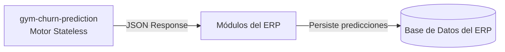

# Modelo de Persistencia (Base de Datos del ERP)

## Arquitectura Stateless
El microservicio `gym-churn-prediction` opera como un **motor de inferencia en memoria (Stateless)** y no posee una base de datos propia. Toda la información persistente, las auditorías y los históricos residen en la base de datos principal del ERP.



## Estructura Recomendada para la Tabla en la Base de Datos del ERP

Para almacenar los resultados generados por el motor de inferencia, se recomienda que el ERP cuente con una tabla (ej. `cliente_evaluaciones_abandono` o `churn_predictions`):

```sql
CREATE TABLE cliente_predicciones_abandono (
    id UUID PRIMARY KEY DEFAULT gen_random_uuid(),
    cliente_id VARCHAR(50) NOT NULL,
    probabilidad_abandono NUMERIC(5, 4) NOT NULL, -- Ej: 0.8245
    nivel_riesgo VARCHAR(20) NOT NULL,             -- 'BAJO', 'MEDIO', 'ALTO'
    horizonte_dias INTEGER NOT NULL DEFAULT 30,
    modelo_version VARCHAR(50) NOT NULL,
    factores_relevantes JSONB NOT NULL DEFAULT '[]'::jsonb,
    recomendaciones JSONB NOT NULL DEFAULT '[]'::jsonb,
    fecha_prediccion TIMESTAMP WITH TIME ZONE DEFAULT NOW(),
    revisado_por_staff BOOLEAN DEFAULT FALSE,
    accion_tomada VARCHAR(255)
);

-- Índices recomendados para consultas rápidas desde el ERP
CREATE INDEX idx_predicciones_cliente ON cliente_predicciones_abandono (cliente_id);
CREATE INDEX idx_predicciones_riesgo ON cliente_predicciones_abandono (nivel_riesgo, fecha_prediccion DESC);
```

## Beneficios
1. **Sin redundancia de datos:** El microservicio no duplica información de clientes ni requiere sincronización de bases de datos.
2. **Consultas unificadas:** El ERP puede cruzar el historial de riesgo con pagos, contratos y cobros en una sola consulta SQL relacional interna.
