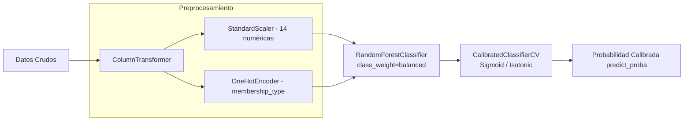

# Pipeline de Machine Learning

El pipeline se encuentra empaquetado en `sklearn.pipeline.Pipeline` e incluye preprocesamiento y modelo clasificador calibrado:

## Manejo de Desbalance de Clases
En el negocio de gimnasios, el abandono suele rondar entre el 20% y el 35%. Se utiliza `class_weight='balanced'` en el estimador base `RandomForestClassifier` para penalizar proporcionalmente el error en la clase minoritaria sin alterar artificialmente la distribución de entrada en validación o prueba.
